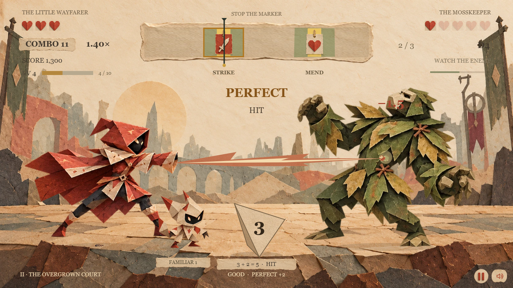

# Paper Dice Duel · 纸艺皮影骰子战斗

一款电脑与手机横屏可玩的时机判定网页游戏。红袍旅人与纸偶伙伴在层叠纸艺舞台上连续挑战三类敌人；点击的时机决定行动质量，四面骰决定攻击是否命中。



## 下载游玩

打开 [v1.0.0 下载页](https://github.com/franzkotkowski330-collab/paper-dice-duel/releases/tag/v1.0.0)。

- `paper-dice-duel-web-v1.0.0.zip`：已构建的网页包。解压后双击 `启动游戏.cmd`，在浏览器访问 `http://127.0.0.1:5318/`。需要 Node.js，推荐 24；这台制作电脑的启动器也支持现有的 `D:\CODEX\node.exe`。
- `paper-dice-duel-source-v1.0.0.zip`：可编辑源码、素材、测试、验收记录和已构建页面。

游戏素材和声音随包提供，运行时无需远程 API、账号或在线素材服务。仓库公开提供源码与下载包，当前没有配置在线游戏托管。

## 操作

鼠标按下、空格或触屏点按战场，停止顶部指针：

- 黄色 `PERFECT`，绿色 `GOOD`，空白 `MISS`。
- 攻击投 D4，3 点及以上命中；PERFECT 加 2，只有天然 4 暴击。绿色攻击可能因骰点不足落空。
- 防御、治疗、速度变化与召唤按操作质量直接生效。升级也在同一判定条上选择，敌人持续行动。
- 连续挑战纸片骷髅、苔叶巨猿和黑纸影魔。影魔的红色骷髅目标需要避开。
- 纸偶每两秒自动攻击，累计三次成功召唤成长一级，最高三级。
- `P`、`Esc` 或暂停按钮暂停；手机竖屏自动暂停，回到横屏后主动恢复。

玩家界面为英文，完整中文说明见 [启动说明](启动说明.md)。首版数值根据确认的制作方案制定，不声称是参考录像的精确参数。

## 本地开发

使用 Node.js 24：

```sh
npm ci
npm run dev
```

运行规则测试和构建：

```sh
npm test
npm run build
node start.mjs
```

生产构建输出到 `dist`；本地静态服务器只监听 `127.0.0.1:5318`。可设置 `PORT` 更换端口。

## 实现

| 文件 | 用途 |
| --- | --- |
| `src/config.ts` | 统一规则参数、行动和敌人配置 |
| `src/engine.ts` | 可注入随机数的规则引擎和结算事件 |
| `src/renderer.ts` | Canvas 2D 场景、动作、纸片效果及四面体旋转投影 |
| `src/assets.ts` | 透明动作图集加载与裁切 |
| `src/audio.ts` | Web Audio 音乐、音效和生命周期 |
| `src/main.ts` | 真实输入、DOM 控件、适配、暂停及本地偏好 |
| `public/assets` | 随包提供的七张 WebP 美术素材 |
| `tests` / `qa` | Node 规则测试与 Playwright 浏览器验收 |
| `art-direction` | 采用的美术参考、素材生成提示词与设计状态 |

基于 TypeScript、Canvas 2D 和 Vite。美术使用内建生图制作本地动作图集；声音由 Web Audio 合成。浏览器验收通过只读状态快照选择输入时机，不提供修改生命或跳关接口。

## 验证

19 项规则测试通过；Chrome 桌面和手机触屏模拟完成三场通关、失败重玩、升级、召唤、暂停恢复、设置保存和横竖屏检查。另验证了素材失败重试、音频信号与生命周期、快速连点和触屏长按去重。

手机真机、Safari/Firefox 实测、实际扬声器听感及操作系统级后台切换尚未验证。详细结果与边界见 [验收记录](验收记录.md)，原始报告和截图在 `evidence`。
